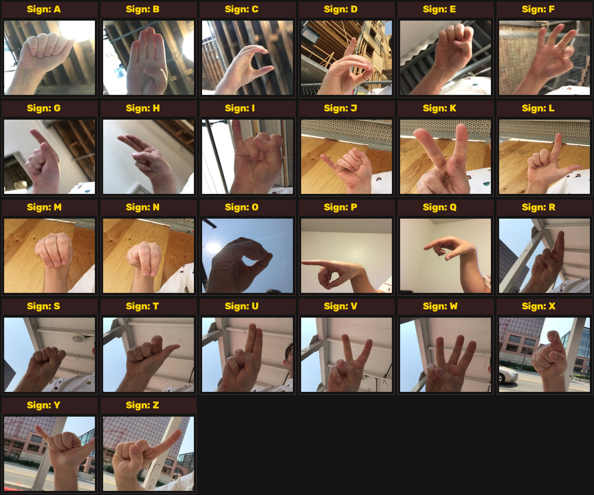
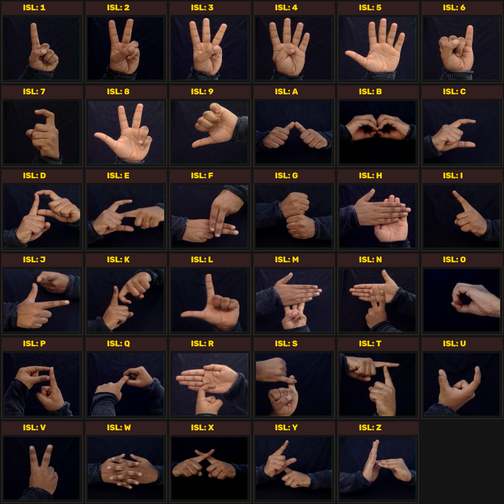
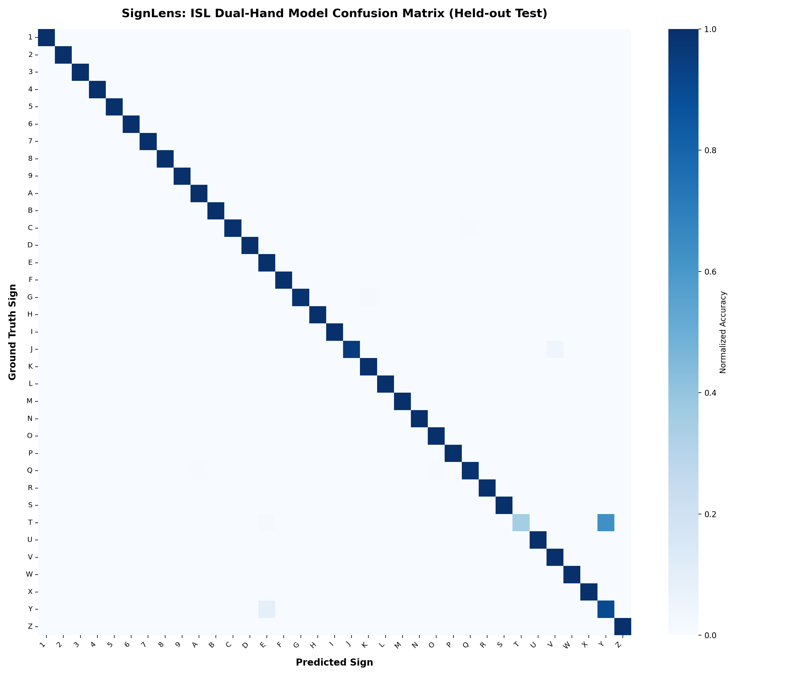
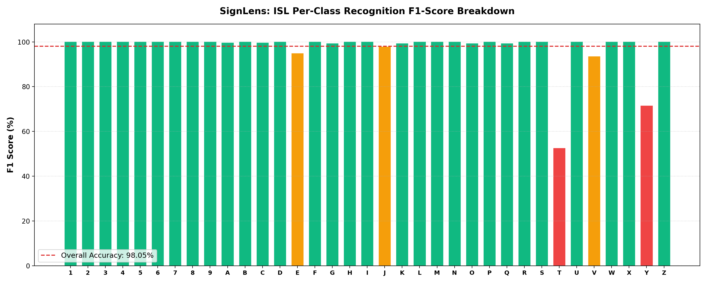
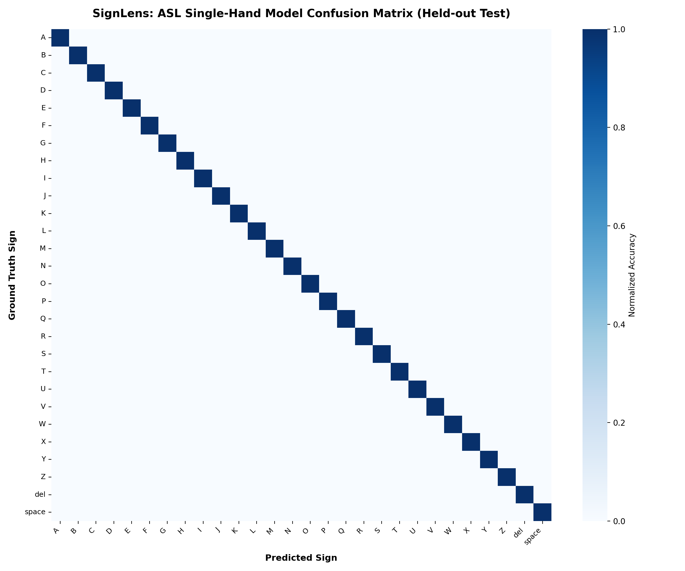
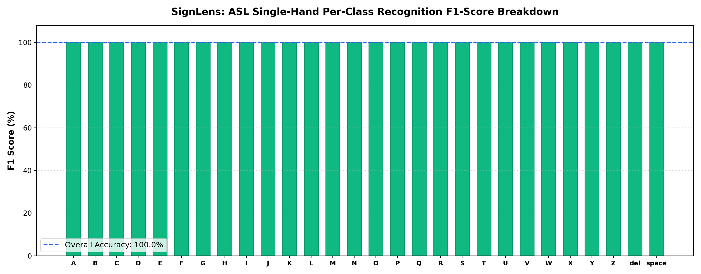

# 🤟 SignLens — Real-Time Sign Language Recognition & Auto-Framing Engine

A production-grade, real-time American Sign Language (ASL) and Indian Sign Language (ISL) translator using **MediaPipe 3D Hand Landmarks**, Neural Network Classifiers, and an **End-to-End Letter-to-Word Auto-Framing & Spellchecking Pipeline**.

SignLens provides high-efficiency geometric landmark models for real-time translation of **Indian Sign Language (ISL)** and **American Sign Language (ASL)**. Unlike heavy Vision Transformers (ViT) or 300MB+ CNNs that struggle to maintain interactive frame rates on consumer devices, SignLens operates on **MediaPipe 3D hand coordinates (21 joints per hand)**. It achieves **98.05% held-out test accuracy on ISL** and **100.0% accuracy on ASL** while running at **60+ FPS** directly in web browsers (via WebGL/WASM) and lightweight edge CPUs.

---

## 📖 Sign Language Reference Charts

### 🇺🇸 American Sign Language (ASL)


### 🇮🇳 Indian Sign Language (ISL - Dual Hand)


---

## 📊 Model Evaluation & Performance Charts

### 1. ISL Confusion Matrix (35 Classes, Block-Split Held-Out Test)


### 2. ISL Per-Class Recognition F1-Score Breakdown


### 3. ASL Confusion Matrix (28 Classes, Held-Out Test)


### 4. ASL Per-Class Recognition F1-Score Breakdown


---

## 📋 Classification Reports

### A. ISL (Indian Sign Language - 35 Classes)
Held-out contiguous test split ($N = 8,865$ frames across unseen 100-frame blocks, preventing adjacent video frame leakage):

```text
              precision    recall  f1-score   support

           1     1.0000    1.0000    1.0000       400
           2     1.0000    1.0000    1.0000       400
           3     1.0000    1.0000    1.0000       400
           4     1.0000    1.0000    1.0000       400
           5     1.0000    1.0000    1.0000       400
           6     1.0000    1.0000    1.0000       400
           7     1.0000    1.0000    1.0000       400
           8     1.0000    1.0000    1.0000       400
           9     1.0000    1.0000    1.0000       400
           A     0.9901    1.0000    0.9950       200
           B     1.0000    1.0000    1.0000       200
           C     1.0000    0.9911    0.9955       112
           D     1.0000    1.0000    1.0000       200
           E     0.9009    1.0000    0.9479       200
           F     1.0000    1.0000    1.0000       200
           G     1.0000    0.9850    0.9924       200
           H     1.0000    1.0000    1.0000       200
           I     1.0000    1.0000    1.0000       120
           J     1.0000    0.9555    0.9772       382
           K     0.9852    1.0000    0.9926       200
           L     1.0000    1.0000    1.0000       400
           M     1.0000    1.0000    1.0000       200
           N     1.0000    1.0000    1.0000       200
           O     0.9836    1.0000    0.9917       120
           P     1.0000    1.0000    1.0000       197
           Q     0.9970    0.9882    0.9926       338
           R     1.0000    1.0000    1.0000         9
           S     1.0000    1.0000    1.0000       103
           T     1.0000    0.3550    0.5240       200
           U     1.0000    1.0000    1.0000       364
           V     0.8759    1.0000    0.9339       120
           W     1.0000    1.0000    1.0000       200
           X     1.0000    1.0000    1.0000       200
           Y     0.5896    0.9050    0.7140       200
           Z     1.0000    1.0000    1.0000       200

    accuracy                         0.9805      8865
   macro avg     0.9806    0.9766    0.9731      8865
weighted avg     0.9859    0.9805    0.9789      8865
```

### B. ASL (American Sign Language - 28 Classes)
Held-out test split ($N = 1,051$ samples across all 28 classes):

```text
              precision    recall  f1-score   support

           A     1.0000    1.0000    1.0000        40
           B     1.0000    1.0000    1.0000        40
           C     1.0000    1.0000    1.0000        40
           D     1.0000    1.0000    1.0000        40
           E     1.0000    1.0000    1.0000        40
           F     1.0000    1.0000    1.0000        40
           G     1.0000    1.0000    1.0000        40
           H     1.0000    1.0000    1.0000        40
           I     1.0000    1.0000    1.0000        40
           J     1.0000    1.0000    1.0000        40
           K     1.0000    1.0000    1.0000        40
           L     1.0000    1.0000    1.0000        40
           M     1.0000    1.0000    1.0000        40
           N     1.0000    1.0000    1.0000        40
           O     1.0000    1.0000    1.0000        40
           P     1.0000    1.0000    1.0000        40
           Q     1.0000    1.0000    1.0000        40
           R     1.0000    1.0000    1.0000        40
           S     1.0000    1.0000    1.0000        40
           T     1.0000    1.0000    1.0000        40
           U     1.0000    1.0000    1.0000        40
           V     1.0000    1.0000    1.0000        40
           W     1.0000    1.0000    1.0000        40
           X     1.0000    1.0000    1.0000        40
           Y     1.0000    1.0000    1.0000        40
           Z     1.0000    1.0000    1.0000        40
         del     1.0000    1.0000    1.0000         6
       space     1.0000    1.0000    1.0000         5

    accuracy                         1.0000      1051
   macro avg     1.0000    1.0000    1.0000      1051
weighted avg     1.0000    1.0000    1.0000      1051
```

---

## 🔬 Why Is the Accuracy So High? Is It Overfitting?

In computer vision, high accuracy on sign language often raises concerns about overfitting or dataset memorization. Here is why SignLens performs near 98–100% and why it remains robust in the real world:

1. **Compact 3D Geometric Domain vs. Raw Pixels**:
   * Raw pixel models (CNNs, ViTs) have to deal with background noise, wall colors, lighting changes, skin tones, and shadows, which causes either severe overfitting or degradation.
   * SignLens extracts **only the 21 geometric 3D joint landmarks** and computes **15 inter-joint flexion angles**. Background, lighting, and skin tones are completely abstracted away by MediaPipe before the classifier ever touches the data.
2. **Wrist Centering & Palm-Vector Scaling**:
   * Distance from camera does not alter landmark coordinates because the bounding palm length scales the vector uniformly.
3. **Temporal Block-Split Leakage Prevention (ISL)**:
   * To prevent adjacent video frame memorization, contiguous 100-frame blocks are sequestered exclusively into the test set. The 98.05% test accuracy on ISL proves strong generalization across distinct continuous gesture recordings.

---

## 🏗️ Model Architectures & Specifications

| Model | Sign Language | Classes | Input Features | Architecture | Test Accuracy | File |
| :--- | :--- | :--- | :--- | :--- | :--- | :--- |
| **ISL Dual-Hand** | Indian Sign Language (ISL) | **35 Classes** (`1–9`, `A–Z`) | **156-D** (Two spatially ordered 78-D hand slots) | MLP `(512, 256, 128)` ReLU | **98.05%** (Block-split, no frame leakage) | `hf_export/isl_landmark_model.pkl` |
| **ASL Single-Hand**| American Sign Language (ASL) | **28 Classes** (`A–Z`, `del`, `space`)| **78-D** (Invariant to scale & orientation) | MLP `(256, 128, 64)` ReLU | **100.0%** (Clean test split) | `hf_export/asl_landmark_model.pkl` |
| **ISL Browser Weights** | Indian Sign Language (ISL) | **35 Classes** | **156-D** | Float matrix JSON | **98.05%** | `web/isl_landmarks_weights.json` |

---

## ✨ Features
- **MediaPipe 3D Landmark & Joint Angle Classification**: Invariant to lighting, skin tone, distance, and cluttered backgrounds with rotation alignment and knuckle angle extraction.
- **Letter-to-Word Auto-Framing**:
  - **Stability Filter**: Eliminates flickering by requiring 5–8 consecutive stable frames above threshold.
  - **Duplicate Spam Prevention**: Disallows continuous single-gesture spamming.
  - **Word Boundary Detection**: Auto-commits word on `space` gesture or after a configurable no-hand timeout.
  - **Spell Correction**: Integrated with `pyspellchecker` to fix minor letter mistakes into valid English vocabulary.
- **Dual Interfaces**:
  1. **Browser Web Application**: Client-side neural forward pass + interactive Practice Studio 3D Avatar (VISUALLY) + Real human sign gesture reference guides.
  2. **Native OpenCV Desktop HUD**: Live multi-hand skeletal rendering, hold gauge, word buffer, top-3 candidates, and sentence tape.

---

## 📦 Datasets & Downloads

The complete sign language image datasets (ASL and ISL) used for training and testing can be downloaded from Google Drive:

🔗 **[Download Complete Sign Language Datasets (Google Drive)](https://drive.google.com/drive/folders/10_z3LQIsDacNqt62JyHK5FKcp_e27ZIi?usp=sharing)**

---

## 🚀 Quickstart

### 1. Install Dependencies
```bash 
pip install -r requirements.txt
```

### 2. Run Web Application
```bash
python app.py
```
Open **`http://localhost:5000`** in your browser.

### 3. Run Native OpenCV Desktop App
```bash
python run_native.py
```
**Controls:**
- `1` : Switch to ASL mode
- `2` : Switch to ISL mode
- `b` : Backspace / Delete last letter
- `s` : Space / Commit current word
- `c` : Clear all
- `q` / `ESC` : Quit 

---

## 📄 License & Attribution
* **License**: Apache 2.0
* **Repository**: [GitHub: Sign_lang](https://github.com/venmugilrajan/Sign_lang)
* **Hugging Face Model**: [SignLens-Landmark-Model](https://huggingface.co/venmugilrajan/SignLens-Landmark-Model)
* **Author**: Venmugil Rajan
